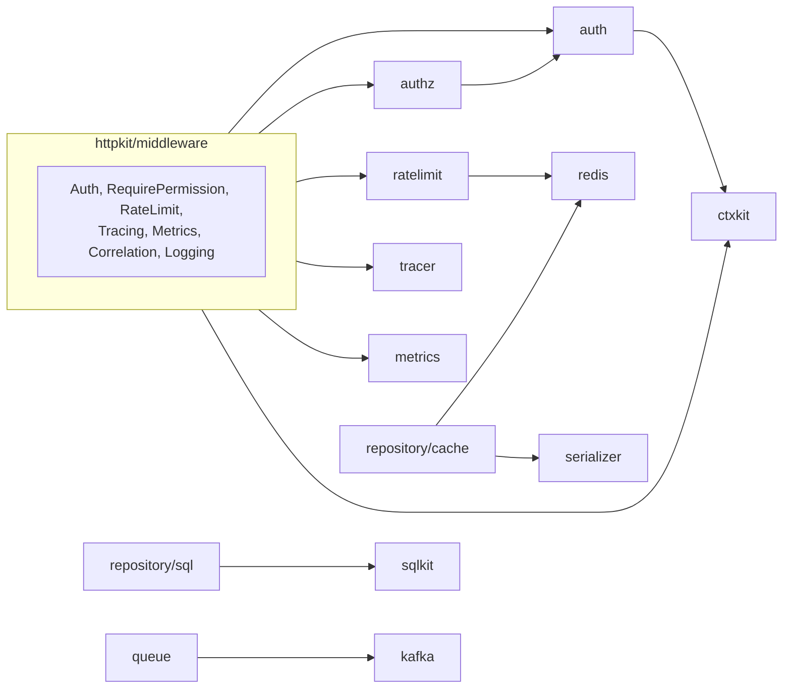
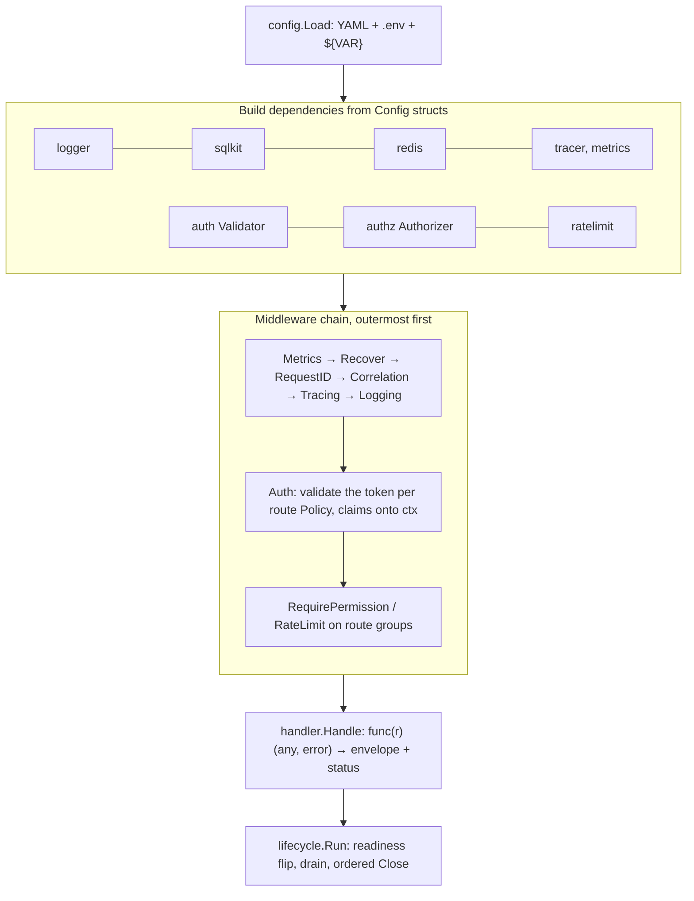
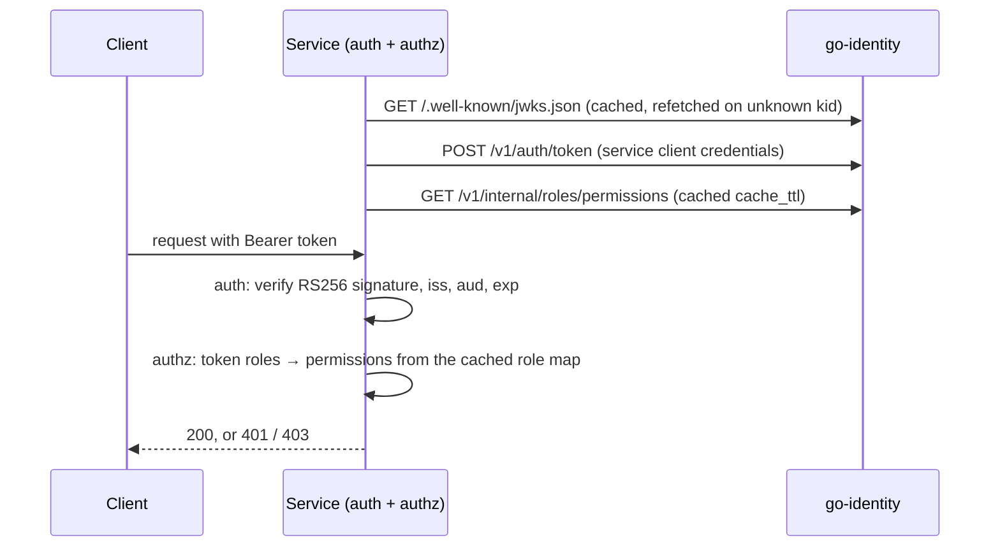

# Architecture

This page explains how go-sdk is shaped and why, for an engineer new to it. The enforceable rules are in
[AGENTS.md](../AGENTS.md). Copy-paste code is in [PATTERNS.md](PATTERNS.md), and testing guidance in
[TESTING.md](TESTING.md).

## Contents

1. [What the SDK is](#1-what-the-sdk-is)
2. [Package map and dependencies](#2-package-map-and-dependencies)
3. [How a service wires the packages](#3-how-a-service-wires-the-packages)
4. [Integration with go-identity](#4-integration-with-go-identity)
5. [Errors](#5-errors)
6. [Logging responsibility](#6-logging-responsibility)
7. [Patterns](#7-patterns)
8. [Key infrastructure behaviours](#8-key-infrastructure-behaviours)
9. [Where to look in the code](#9-where-to-look-in-the-code)

## 1. What the SDK is

A set of **independent packages with no entry point**. There is no root package to import and no initialisation
order. A consumer takes `errorz` without pulling in `sqlkit`, or `redis` without `httpkit`. Each consumer's dependency
surface stays small, and packages can evolve on their own.

It is the infrastructure layer only. Business rules live in the services built on it
([go-identity](https://github.com/biairmal/go-identity),
[go-service-template](https://github.com/biairmal/go-service-template)).

| Term | Meaning |
|---|---|
| Leaf package | `errorz`, `logger`, `common/dto`. Any package may import them |
| Seam | An exported interface (`auth.Validator`, `redis.Client`, `queue.Publisher`) that hides the backend, so tests and deployments can swap it |
| NoOp | A working do-nothing implementation shipped with a seam (`logger.NewNoOp()`, `tracer.NewNoOp()`) for tests and disabled features |

## 2. Package map and dependencies

The full list with one line per package is the [package map](../AGENTS.md#package-map). The arrows below are every
import between SDK packages, apart from the leaf packages, which everything may use:



Packages not shown (`config`, `validator`, `crypto`, `circuitbreaker`, `lifecycle`, `mailer`, `sqlkit`, `redis`,
`kafka`) import only the leaf packages and third-party libraries.

Two rules keep this graph flat:

- **Middleware lives in `httpkit/middleware`, not in the feature package.** `auth` validates tokens and knows
  nothing about HTTP. `httpkit/middleware.Auth` adapts it to a request. A service that validates tokens on a queue
  consumer imports `auth` without pulling in `httpkit`.
- **Dependencies point down only**, from the HTTP edge to the data and infrastructure layers:

```text
HTTP boundary        httpkit (handler adapter, middleware, response envelope)
      │  maps errorz codes → HTTP status (the only HTTP-specific step)
Application/service   (consumer code: business logic, transaction orchestration)
      │
Data access          repository  →  repository/sql, repository/cache
      │
Infrastructure       sqlkit (database/sql, leader/follower)   redis (go-redis)   kafka
```

Lower layers never import the HTTP layer and never know about HTTP transport. They may return `errorz` errors (see
section 5).

## 3. How a service wires the packages

A service built on the SDK (go-identity and go-service-template both do this in `internal/app`) loads config, builds
the dependencies from it, and runs one middleware chain:



- **Every package takes its own `Config` struct**, so a service embeds them all in one app config and fills it from
  one YAML file.
- **`ctxkit` carries request-scoped IDs.** Middleware sets the request, correlation, trace and user IDs, and the
  logger reads them back, so every log line has them without passing them around.
- **`lifecycle.Run`** owns shutdown. On a signal it marks the service not ready, waits the drain delay so load
  balancers stop sending traffic, drains the HTTP server, then closes the registered resources one by one in
  registration order. The HTTP drain and the cleanup have separate timeouts.

## 4. Integration with go-identity

`auth` and `authz` are the client side of [go-identity](https://github.com/biairmal/go-identity). A resource service
never calls identity on the request path:



- **`auth`** validates with HS256, RS256 (static key or JWKS) or a `remote` validator. A monolith issues and
  validates in one process. Splitting out identity later is a config change, not a code change.
- **`authz`** answers "may this caller do X?". Permissions come from one of three sources: the token's `perms` claim
  (`token`), a static role map (`config`), or identity's role map fetched with a service token (`identity`). The
  super admin claim passes every check. `RequireIn` adds resource-scoped roles through a `ScopeResolver` that the
  service implements.

## 5. Errors

`errorz` is the shared structured-error type for the whole ecosystem, **not** an HTTP concern. Every layer and every
SDK package may return it: `sqlkit`, `redis`, `repository`, `config`, and consumer code alike.

Its codes (`CodeNotFound`, `CodeBadRequest`, ...) are a **transport-agnostic taxonomy**. `httpkit` maps them to HTTP
status at the edge (`NotFound` → 404). The same taxonomy could map to gRPC status codes, CLI exit codes or a
dead-letter reason. The mapping lives at the transport boundary, and the error type travels through every layer.

- Return an `errorz` error with a **code**, and **wrap the cause** so `errors.Is` and `errors.As` still work.
- Compare sentinels with `errors.Is(err, errorz.ErrNotFound)`. Sentinels travel, and type assertions don't.
- Declare `error` in signatures, never `*errorz.Error`, to avoid the typed-nil trap.
- Give errors a client-safe message. The envelope sends the error's own text when there is no message (see
  [SECURITY.md](../SECURITY.md)).

Canonical snippets: [PATTERNS.md](PATTERNS.md#sentinel-errors-errorz).

## 6. Logging responsibility

Libraries **return errors instead of logging them**, so callers stay in control of output. `logger.Logger` is
accepted only as an *optional* constructor parameter, and only by packages with internal state worth tracing (query
execution in `repository/sql`, connection lifecycle in `sqlkit`). It is always nil-safe: a nil logger means silence,
never a panic. The stdlib `log` package is banned in library code, because callers cannot suppress or redirect it.

## 7. Patterns

| Pattern | Problem it solves | How |
|---|---|---|
| Config struct, YAML first | A service must configure every package from one file | Exported `Config` with `mapstructure` snake_case tags, `DefaultConfig()`, `Validate()`. `New` fills zero fields from the defaults |
| Options only for live dependencies | Config must stay serialisable | `WithX` options carry loggers, HTTP clients and callbacks, never plain values |
| Interface first, NoOp shipped | Tests and disabled features need a stand-in | Each seam ships a NoOp. Generated gomock mocks live in the separate `mocks` module, so gomock never enters a consumer's build |
| Stale-while-error caches | A dependency outage shouldn't become a wrong answer | `authz` serves a stale role map for a bounded time, then fails with 503. JWKS refetches on an unknown `kid` with a cooldown |
| Transaction on the context | Several repositories must share one transaction | `sqlkit.InjectTx` puts the `*sql.Tx` on the context. Repositories pick it up through `GetConnection` |
| Fail-open or fail-closed by choice | A limiter backend outage shouldn't silently decide policy | `ratelimit` returns the error. The middleware fails open by default, and `WithFailClosed()` makes it refuse |

Code for each is in [PATTERNS.md](PATTERNS.md).

## 8. Key infrastructure behaviours

- **`sqlkit.DB` leader/follower.** `Leader()` always returns the write connection. `Follower()` round-robins across
  healthy followers and falls back to the leader when none are healthy. Health checks run in a background goroutine,
  off the hot path.
- **Transaction injection.** `sqlkit.InjectTx(ctx, tx)` puts a `*sql.Tx` on the context, and `sqlkit.ExtractTx(ctx)`
  retrieves it. Repositories route through `GetConnection` and `GetReadConnection`, so an injected transaction is
  used whenever one is present.
- **`repository/sql` reflection.** `SQLRepository` reads `db:"column_name"` struct tags at construction. ID
  detection: a zero `int64` uses `LastInsertId`, a zero UUID or string uses `RETURNING id` (Postgres), and a
  non-zero ID is inserted as given.
- **`httpkit` handler adapter.** Handlers are `func(*http.Request) (any, error)`, converted by `handler.Handle`. On
  error, `StatusCodeFromError` maps the `errorz` code to an HTTP status. On success, returning `*response.Success`
  sets a custom status code.

## 9. Where to look in the code

| Question | Open |
|---|---|
| What does package X do and how do I use it? | `lib/<x>/README.md` |
| Which middleware exists, and in what order do I chain it? | `lib/httpkit/middleware`, [httpkit README](../lib/httpkit/README.md) |
| How are tokens validated? | `lib/auth/jwt.go`, `jwks.go`, `policy.go` |
| How are permissions decided? | `lib/authz`, `source_identity.go` for the identity role map |
| How do I test against an SDK interface? | [TESTING.md](TESTING.md), `mocks/` |
| How do I add a package? | [NEW_PACKAGE_CHECKLIST.md](NEW_PACKAGE_CHECKLIST.md) |
